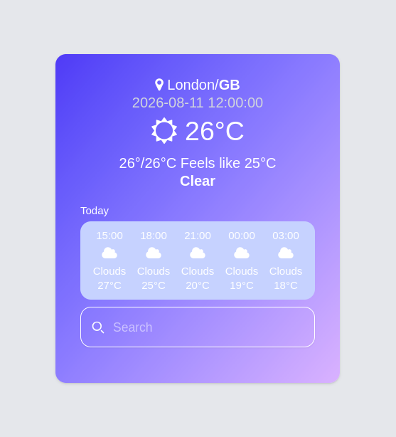

# Vite Meteo Weather App

A lightning-fast, lightweight weather application built with the OpenWeather API. It features Redis caching to optimize API calls, rate-limiting to prevent abuse, and a clean separation of concerns containerized via Docker.

(https://img.youtube.com/vi/GQFwjFh9cFc/hqdefault.jpg)](https://www.youtube.com/watch?v=GQFwjFh9cFc)

<h1 align='center'>
    
</h1>

## Why This Stack?

While a standard weather app only requires basic API fetching, this project was architected to demonstrate robust, production-grade features:

* **Redis Caching:** The free tier of the OpenWeather API limits requests to 60 calls per minute. To prevent hitting rate limits under high traffic, the app caches weather data in a Redis database. Subsequent requests for the same city fetch the stored JSON data directly, drastically reducing external API usage.
* **Rate Limiting:** Protects the application from DoS attacks and request API abuse using `express-rate-limit` paired with `rate-limit-redis`.
* **Separation of Concerns:** The backend and frontend are completely decoupled. The backend is built with **Express and TypeScript**, while the client uses **Vite and React**, allowing for flexible frontend scaling.
* **Dockerization:** Fully containerized using **Docker Compose** to ensure seamless deployment across different environments without manual dependency management or runtime discrepancies.

---

## Getting Started

### prerequisites
**make sure you have the following to install on your system before proceeding:**
  * Node.js: Version 24.x (Recommended)
  * Docker & Docker Compose (Optional, for containerized setup)
  * npm (comes bundled with Node.js)

### Project Structure
```
.
├── assets
├── backend
├── client
├── compose.yaml
├── .env.example
├── .gitignore
└── README.md
```

## The Setup
 
---
## Local host installation

Navigate to the backend directory and copy the example environment file

```
cd backend
cp .env.example .env
```

```open the .env file and set up the variable:``` 

```bash
PORT=3000
NODE_ENV=development
WEATHER_API_KEY=your_openweather_api_key_here
REDIS_URL=redis://localhost:6379
```

> [!NOTE]
> A valid OpenWeather API key is required. Get a free key at OpenWeather.
 

---
## Docker Installation 

Ensure Docker and Docker Compose are installed on your system based on your operating system:

* **Linux:** Install Docker Engine and Docker Compose using your distribution's package manager or the official [Docker Linux Installation Guide](https://docs.docker.com/engine/install/).
* **Windows & macOS:** Download and install [Docker Desktop](https://www.docker.com/products/docker-desktop/).

Once installed, verify the installation by running:
```bash
docker compose version
```

## setup the env

copy the example environment file

```
cp .env.example .env
```

```open the .env file and set up the variable:``` 

```bash
PORT=3000
NODE_ENV=development
WEATHER_API_KEY=your_openweather_api_key_here
REDIS_URL=redis://redis:6379
```

> [!NOTE]
> A valid OpenWeather API key is required. Get a free key at OpenWeather.

## Run your docker
After setting up .ENV, run docker into command:
<br>
```docker compose up -d``` 

## References
- **UI Inspiration:** https://freefrontend.com/tailwind-weather-widgets/
- **CSS framework:** https://tailwindcss.com
- **redis rate limit:** https://redis.io/docs/latest/develop/use-cases/rate-limiter/
- **redis caching:** https://blog.stackademic.com/building-a-weather-app-with-redis-caching-using-node-js-and-express-51088d1146b8
- **backend express:** https://blog.logrocket.com/express-typescript-node/

